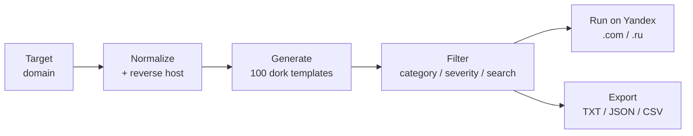

<h1 align="center">
  
</h1>

<p align="center">
  <b>Yandex dork generator for reconnaissance, OSINT, and authorized security research.</b>
</p>

<p align="center">
  
  
  
  
  
</p>

<p align="center">
  <a href="https://defaultsecc.github.io/yandex-recon"><b>🔴 Launch Live Tool</b></a>
</p>

<p align="center">
  <a href="#overview">Overview</a> •
  <a href="#features">Features</a> •
  <a href="#dork-categories">Categories</a> •
  <a href="#supported-operators">Operators</a> •
  <a href="#usage">Usage</a> •
  <a href="#local-development">Local Dev</a> •
  <a href="#export-formats">Export</a> •
  <a href="#responsible-use">Responsible Use</a>
</p>

---

## Overview

YandexRecon turns a single target domain into **100 ready-to-run Yandex dork
queries** for subdomain enumeration, exposed-file discovery, admin-panel hunting,
and general reconnaissance. Yandex often indexes content that other search engines
miss, which makes it a useful second source during the recon phase of a pentest or
bug bounty engagement.

Everything runs in your browser. There is no backend, no database, and no tracking.

> [!WARNING]
> **Authorized use only.** This tool is for penetration tests, permitted bug bounty
> programs, and assets you own or have written permission to test. See
> [Responsible Use](#responsible-use).



## Features

- **100 dork templates** across 5 categories, generated instantly for any domain.
- **Subdomain enumeration** with the Yandex `rhost:` reversed-host wildcard,
  including an A–Z brute-force set (`rhost:com.example.a*` … `z*`).
- **Category filters**: Subdomains, Open Directories, Sensitive Files, Admin & Login, Recon.
- **Severity filters**: Critical, High, Info.
- **Engine switching** between `yandex.com` and `yandex.ru`.
- **One-click Run on Yandex**: opens the URL-encoded search in a new tab.
- **Copy** a single query or every visible query at once.
- **Export** results as TXT, JSON, or CSV.
- **Favorites** to star and filter your most-used dorks.
- **Search history** that remembers recent targets.
- **Custom Dork Builder** to compose queries from operators or enter them freeform.
- **Live stats dashboard** with Total / Critical / High / Info counts.
- **Grid and List** view modes, plus real-time query search.

## Dork Categories

| Category | Dorks | Focus |
| --- | --- | --- |
| Subdomains | 29 | `rhost:` wildcard, `site:`, `host:`, A–Z brute-force |
| Sensitive Files | 24 | `.env`, configs, backups, SQL dumps, keys / PEM, logs, office docs |
| Recon | 19 | Staging / dev / test hosts, API, GraphQL, Swagger, robots.txt, phpinfo |
| Admin & Login | 16 | `/admin`, `/login`, phpMyAdmin, cPanel, wp-login, dashboards |
| Open Directories | 12 | `Index of` listings: `/.git/`, `/.ssh/`, `/backup/`, `/uploads/` |

| Severity | Dorks |
| --- | --- |
| 🔴 Critical | 19 |
| 🟠 High | 31 |
| 🔵 Info | 50 |

## Supported Operators

| Operator | Example | Purpose |
| --- | --- | --- |
| `site:` | `site:example.com` | Restrict results to a domain and its subdomains |
| `host:` | `host:example.com` | Match pages on a specific host |
| `rhost:` | `rhost:com.example.*` | Reversed-host wildcard for subdomain discovery |
| `url:` | `url:example.com/admin` | Match a URL or path |
| `mime:` | `site:example.com mime:pdf` | Filter by document type |
| `ext:` | `site:example.com ext:sql` | Filter by file extension |
| `intitle:` | `site:example.com intitle:"index of"` | Match words in the page title |
| `inurl:` | `site:example.com inurl:login` | Match words in the URL |

## Usage

No installation needed. Open the live tool:

**https://defaultsecc.github.io/yandex-recon**

1. Enter a target domain, e.g. `example.com`.
2. Pick an engine: `yandex.com` or `yandex.ru`.
3. Filter by category, severity, or search text.
4. Click **Run on Yandex** for any dork, or copy / export the full set.
5. Star useful dorks so they show up under **Favorites**.

> [!TIP]
> Results depend on what Yandex has indexed. Use `rhost:` dorks together with your
> usual subdomain tooling (subfinder, Chaos, crt.sh) instead of relying on them alone.

## Local Development

| Component | Requirement |
| --- | --- |
| Node.js | 18 or newer |
| Stack | React 18, TypeScript, Vite 5, Tailwind CSS, lucide-react |

```bash
git clone https://github.com/defaultsecc/yandex-recon.git
cd yandex-recon

npm install
npm run dev        # start dev server
npm run build      # type-check and build to dist/
npm run preview    # preview the production build
npm run deploy     # publish dist/ to GitHub Pages
```

### Project structure

```text
src/
├── components/    UI: TargetInput, FilterBar, DorkGrid, DorkCard, StatsCards, CustomDorkBuilder …
├── data/          dorks.ts (templates), operators.ts (operator reference)
├── lib/           yandex.ts (URL builder), domain.ts, export.ts, storage.ts, clipboard.ts
└── types/         dork.ts
```

## Export Formats

| Format | Contents |
| --- | --- |
| TXT | One query per line, ready for scripting |
| JSON | Full metadata: category, severity, title, description, query |
| CSV | Spreadsheet-friendly version of the JSON export |

## Privacy

- All query generation happens locally in your browser.
- Favorites, history, view mode, and engine choice are stored in `localStorage` only.
- Nothing is sent anywhere until you click **Run on Yandex**, which opens a normal
  Yandex search in a new tab.

## Responsible Use

YandexRecon is built for authorized security testing and educational purposes.

- Test only assets you own or have explicit written permission to assess.
- Stay within the scope and rules of your engagement or bug bounty program.
- Search results may expose **real data belonging to real organizations**. Do not
  download, retain, or misuse it.
- Follow responsible disclosure and report findings to the affected owner or program.
- You are responsible for your use of this tool.

---

## Acknowledgements

<p align="center">
  
</p>

**YandexRecon is an independently developed project by DefaultSec.** It is not
affiliated with, endorsed by, or sponsored by Yandex.

If you find this project useful, consider giving it a ⭐ on GitHub.

---

## Disclaimer

This software is provided for authorized security testing and educational purposes
only. The authors accept no liability for misuse or damage. By using it you confirm
you have permission to test the targets you provide and accept full responsibility
for your actions.

## License

MIT
